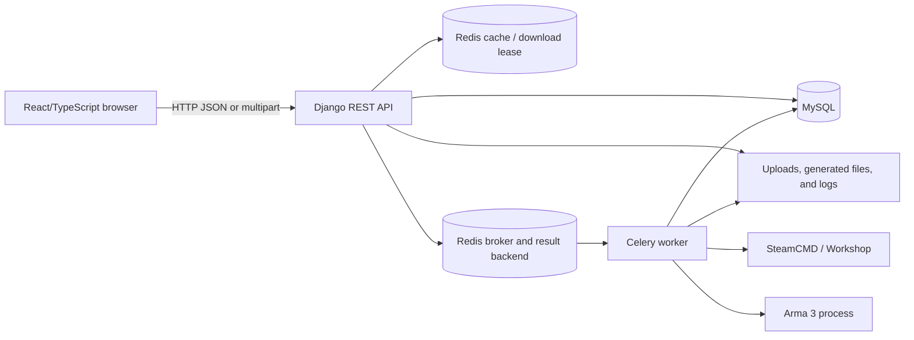

# Architecture

This architecture reflects the accepted source at commit 9da951f and its guarded regression evidence (2026-11-09).

ArmaServerManager is a React/TypeScript browser client backed by a Django REST API. MySQL stores relational state; Redis supports Celery, task results/cache, and a download coordination lease. SteamCMD, Workshop content, generated server files, and Arma processes remain outside the API transaction boundary.

## Component boundaries

The browser requests operations through the API and polls a task ID. The backend persists task ownership before publishing work. A task ID does not authorize access: the status endpoint checks the persisted instance binding and owner-or-staff policy.

## Authentication and frontend state

The browser stores the Knox token under `Token` and sends it in the authorization header. Protected content waits for the identity/admin lookup. Transient network, timeout, and server errors retain the token and show a retry state. A 401 for the current token clears it; a delayed 401 for a stale token does not clear a newer session. Pending/null task results remain active, while per-instance responses are protected against stale task records. Staff see main, own, then other-user instance sections. Shutdown display uses the instance's `shutdown_at`, not a browser-wide clock value.

## Lifecycle coordination

Lifecycle reservations use a single database coordination row and acquire it before locking owners, instances, or ports. Starts reserve capacity before dispatch, including starting reservations, and duplicate active starts return the current task ID. Lifecycle workers claim a binding once and fence signals and completion to the current task attempt and run ID.

During bounded startup identity resolution, the worker accepts the Popen root when its PID/birth identity and run marker remain valid and its executable matches the persisted expected Arma executable; it rechecks that identity before acceptance. If the Popen root is a shell or otherwise has a different executable, it examines descendants and accepts only one candidate matching the expected executable, run marker, birth identity, and verified ancestry, then rechecks the selected candidate and root. If no unique candidate is verified before the deadline, the instance remains unknown and needs operator attention. Stop-time descendant signal checks are separate: descendants are checked by birth time, run marker, and verified ancestry, without comparing each child's executable to the root. Legacy rows with prior running/PID state are marked unknown and receive no signal based on PID or port alone. These checks reduce wrong-target signals but do not prove absolute process containment.

A one-hour user-instance shutdown deadline is per instance and is scheduled after successful launch. Stale deadline/stop deliveries are fenced to the run and attempt. A deadline is not derived from the browser clock.

## Managed files

The accepted journal primitive stages regular files privately, verifies target identity, publishes without clobbering, preserves prior versions for rollback, and retains structured evidence when rollback is uncertain. A database commit callback is the boundary after which cleanup failure becomes `cleanup_pending`; the journal does not claim atomicity across a database and filesystem or across power loss.

Create, admin preset replacement, and first-start admission call the read-only `preflight_managed_root_layout(config_snapshot)` before opening operation loggers, using the same config snapshot as the operation. It compares private siblings against configured, static, media, instance preset/log, and mission-upload roots. The root inventory includes `Missions.mission_file`; an unsupported or unenumerable FileField storage fails closed for mutations using private staging, but mission upload/replacement behavior is unchanged.

For each unique parent of a trusted media or Arma root, an administrator must provision an existing sibling `.asm-private` directory outside all public/trusted roots and on the same filesystem. The test suite provisions temporary sibling directories; no production directories were provisioned. Runtime code does not create or chmod/chown private roots. Read-only preflight does not require those private directories to exist, but mutations fail safely until they are provisioned. The contract supports local `FileSystemStorage`, safe path components, and same-filesystem hard links.

First-start log bytes are staged with `staged_first_instance_log` in the lifecycle/database transaction and published through the journal. Only the database `on_commit` callback marks the journal committed. In regression cases with verified successful compensation, an expected empty per-user log parent may remain and no orphan file bytes or private stages remained. If a restore or cleanup step fails or cannot be verified, unresolved public paths or private stage/backup evidence may remain; repair evidence is retained where available. After commit, cleanup failure is `cleanup_pending`; the service does not restore old files over committed metadata. Direct model deletion keeps Django’s `(count, per_model_count)` return, attaches a path-free `_asm_cleanup_pending` summary and static administrator warning, and clears the deleted caller object’s primary key after success. Bulk QuerySet/admin deletion bypasses this contract and is unsupported.

## Downloads

The accepted lease primitive uses an owner token with atomic SET-NX acquisition, Lua-based renewal, and compare-delete release. The dedicated client uses the default django-redis client configuration; unsupported cache hooks/options are rejected rather than copied. Its blocking TCP/TLS pool is capped at four connections, connect/socket timeouts are at most one second, and Redis text uses strict UTF-8 decoding. The heartbeat renews ownership throughout the existing 600-second rate-limit wait and the 7,200-second SteamCMD execution window. The lease by itself is not a durable claim or a fence.

All downloads share SteamCMD cache/assets, so new download admission reserves one global unfinished-download slot. Same-instance requests reuse the existing task ID; other lifecycle/global conflicts return a static 409 before config, preset, or disk preflight. New work uses one coherent configuration snapshot and creates a unique worker-owned workspace. The worker claims a persisted task binding once, clears readiness in the claim transaction, checks the current claim and owner-token lease before shared writes/publication, and verifies installed content before setting readiness true. Cancellation checks cover SteamCMD, retry waits, ghost-folder publication, and output handling. Admission and attention transitions share the lifecycle coordinator. The coordination boundary is one ASM database/Redis installation; external writers and other databases are outside it.

Post-download verification checks the missing Workshop ID list returned by `check_installed`; its other return value contains filesystem paths, not Workshop IDs. This verifies directory existence, not the completeness or integrity of each mod's files.

The lease is not a standalone durable fence. Initial OS hostname resolution produces a numeric address before lease acquisition and outside the bounded Redis I/O guarantee. The test runner blocks five Python DNS resolver entry points, but this does not prove isolation against native-code lookup. Fake/client proofs do not establish live Redis/TLS behavior.

Cancellation closes callback **admission** through a short gate. A callback admitted before cancellation may be suppressed or may complete later; the contract does not promise that its first physical instruction cannot occur after cancellation. Existing bounded output-reader/callback resources are reused; cancellation adds no callback-monitor or cleanup thread and no callback queue. Each cancellable supervisor uses two daemon reader threads. The Redis lease uses its bounded heartbeat thread. If process cleanup or reader quiescence is uncertain, the worker retains its workspace and unfinished binding for attention. It does not close a pipe while a reader may be active.

Attention persistence runs before logger teardown. The opted-in logger seals new handler admission and defers closing only a handler with an active record; that handler closes itself when the record unwinds. If a callback/record never returns, its existing reader/handler resources may remain until it returns or the process restarts. There is no new cleanup/monitor thread. Ordinary logger teardown remains synchronous.

## Configuration and logs

Configuration uses fresh snapshots and locked merge updates with sibling temporary-file publication. POSIX reads of an existing file do not need the lock; Windows reads use it. The exact local ownership/mode contract and platform limits are in [configuration.md](configuration.md) and ADR-0002.

Application operation logs and the media-backed Arma instance log are separate. Operation logs are written immediately and have no automatic retention/rotation. They may contain operational details and must be protected through an authorized operator procedure.
## Final source safeguards

Stop, compensation, and reconciliation check the persisted expected executable for the direct/discovered root alongside its PID birth time and run marker. Descendant candidates use birth-time, run-marker, and verified-ancestry checks; they are not each compared to the root executable. A mismatch or uncertain identity remains unknown and is not signalled. New start-task messages carry only instance and run identifiers; the worker accepts but discards the legacy `arma3_dir` keyword and derives its launch directory from persisted process data. A preparation failure before secret-redactor initialization uses a fixed diagnostic without formatting the original exception. The isolated runner blocks five Python resolver entry points; this is not a native-code network sandbox. Shutdown-time parsing uses the ISO offset hour and minute captures.
