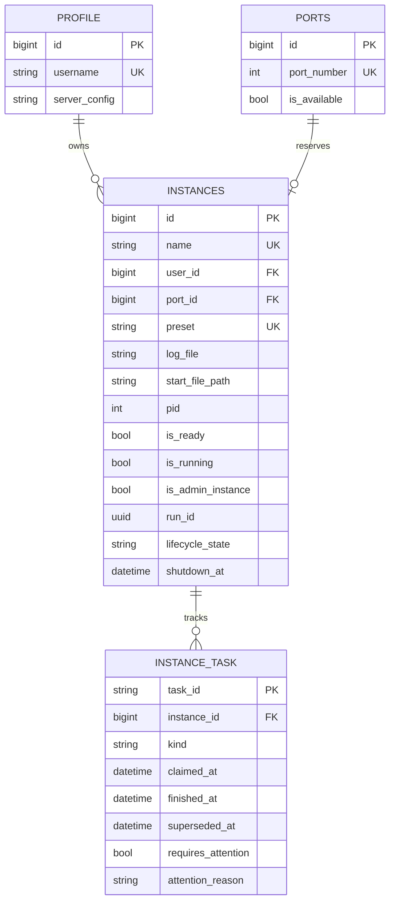

# Data model

This model guide was checked against the accepted source at commit 9da951f (2026-11-09). Models and migrations remain authoritative.

The Django models and migration sequence in `backend/main/migrations/` define the schema. The configured application database is MySQL. Applied migrations are history and must not be rewritten.

## Entities

### `Profile`

The custom `AbstractUser` configured as `AUTH_USER_MODEL`. The username is unique. A profile may store a `server_config` path. The profile manager hashes passwords for normal and superuser creation.

`Profile.delete()` delegates single-profile deletion to the managed service. It preflights every owned instance and file, rejects busy or unknown work without autostopping, releases owned ports only on the guarded path, and removes `server_config` only when no other row references it. `Instances.delete()` retains that per-user configuration. Both overrides preserve Django’s `(count, per_model_count)` result and attach a path-free `_asm_cleanup_pending` summary to the caller object; cleanup-pending emits a static administrator warning, and successful deletion clears the caller primary key. Bulk `QuerySet.delete()` and Django admin bulk deletion bypass these overrides and are unsupported for managed cleanup.

### `Instances`

An instance has a unique `name`, owning `Profile`, unique uploaded `preset`, optional `log_file`, optional generated `start_file_path`, one-to-one `Ports` relation, readiness/running flags, an administrative flag, and `created_at`.

The offline `relocate_arma_paths` management command can validate and transactionally update expected instance `start_file_path` and profile `server_config` references after their files have been copied. It does not move files or update runtime configuration; see [files and missions](domain/files-and-missions.md).

Lifecycle fields added by migration `0010_instance_lifecycle` are:

- `run_id`: UUID for the current server run.
- `process_created_at` and `process_executable`: process identity observations used with the PID.
- `lifecycle_task_id`, `start_claimed_at`, and `timeout_task_id`: active lifecycle task and claim metadata.
- `lifecycle_state`: `stopped`, `starting`, `running`, `stopping`, or `unknown`.
- `shutdown_at`: per-instance deadline exposed read-only to the UI.

`InstanceSerializer` exposes `id`, `name`, `user`, `preset`, `log_file`, `start_file_path`, `port`, `pid`, `is_ready`, `is_running`, `is_admin_instance`, `created_at`, `lifecycle_state`, `shutdown_at`, and `active_tasks`. In particular, `pid` and `start_file_path` are public read-only fields. Private lifecycle metadata—`run_id`, `process_created_at` (birth time), `process_executable` (expected executable), and persisted task-binding rows—is not serialized. `active_tasks` contains operation kinds mapped to string task IDs.

### `InstanceTask`

Migration `0009_instance_tasks` added a string primary-key task ID, owning instance foreign key, operation kind (`start`, `stop`, or `download`), creation time, and finish time. Migration `0010_instance_lifecycle` added claim and supersession timestamps. Migration `0011_download_attention` added:

- `requires_attention`
- `attention_reason` (`process_cleanup_unconfirmed` or `worker_state_unverified`)
- `attention_workspace`, a private operational path that is never returned by the API.

Task bindings are persisted before dispatch. A claim makes a worker delivery single-use; a superseded binding cannot act on a newer attempt. The public `active_tasks` map returns IDs only, not internal records or paths.

The accepted worker uses durable binding claims and these attention fields. The accepted Task 7c3 API checks the persisted binding before backend access, returns static `REQUIRES_ATTENTION` for persisted attention, and converts terminal Celery disagreement on any unfinished DOWNLOAD into durable `worker_state_unverified` attention. Attention remains unfinished and fences later queue delivery, claim, and readiness publication.

### `InstanceLifecycleLock`

A single fixed row (ID 1) serializes lifecycle decisions across instances. The migration seeds the row and marks existing rows that show a running state or PID as `unknown` for fail-closed handling. SQLite tests cannot prove MySQL lock behavior under production concurrency.

### `Ports`

Contains a unique integer `port_number` and an `is_available` flag. Creation reserves a row under the lifecycle ordering rules; deletion releases it only through the successful guarded cleanup transaction.

### `Missions`

Stores an uploaded `mission_file` under `missions/`. Same-filename replacement requires staff and no running instances. There is no uploader relation or version history. Deletion and replacement use a managed file journal and reject unsafe or shared file references.

### `PreparedPreset`

Stores a display name, unique case-folded name key, and a unique file reference below `prepared_presets/`. Instances own separate copies; deleting a catalog entry does not delete instance presets.

## Relationship summary

The lifecycle mutex is a coordination row, not a relation to an individual instance.

## Consistency boundaries

- The database, filesystem, Redis/Celery, and host process table do not share one distributed transaction.
- Before the database commit marker, the file journal attempts compensation. Clean restoration/removal is established only when compensation succeeds and verifies the result; accepted regressions cover those successful cases, where an empty per-user log parent may remain. An unsuccessful or uncertain restore/cleanup may leave unresolved public destinations or private stage/backup evidence, retained for repair where available. The journal does not promise power-loss or database/filesystem atomicity.
- A post-commit private-stage cleanup failure is reported as cleanup pending and must not roll back committed database state.
- Only a single `Instances.delete()` or `Profile.delete()` call routed through the managed service has the intended cleanup behavior; queryset/admin bulk deletion is unsupported for managed cleanup.
- Lifecycle state may remain unknown when process identity or cleanup cannot be verified. No signal is authorized by PID or port alone.
- Tests using SQLite, fake Redis, mocked processes and temporary files do not prove live MySQL row locking, Redis/TLS behavior, SteamCMD, Arma, or production migrations.

## Download admission consistency

The accepted HTTP path orders same-instance reuse and global/lifecycle conflicts before new-admission config, preset, and disk preflight while the lifecycle mutex is held. Failed preflight leaves no binding. Task-status attention and download claims use the same lifecycle coordinator; another unfinished claimed or attention-fenced download blocks worker claim/current-claim/readiness checks. A healthy unclaimed legacy download does not alone block a worker claim. The SQLite/injected coordinator tests prove application ordering only; they do not prove production MySQL row-lock timing.

Stop, compensation, and reconciliation use the saved `process_executable` together with PID birth time and the run marker. A mismatch or unverifiable identity leaves lifecycle state unknown and does not trigger a signal. The persisted field already existed; this repair required no schema migration.
